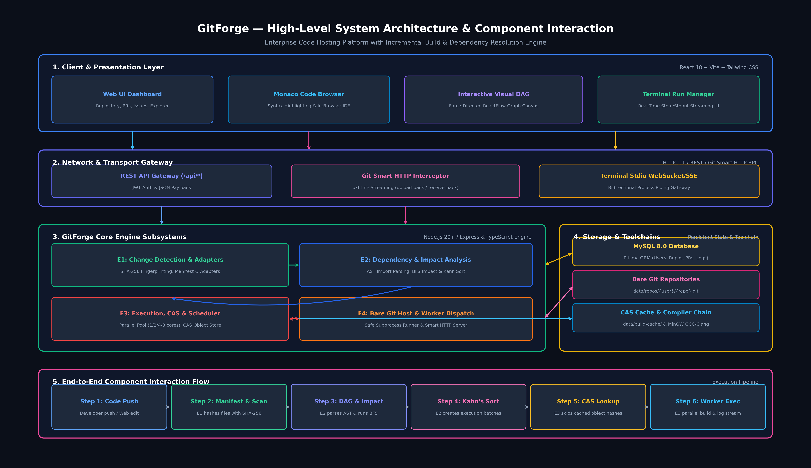
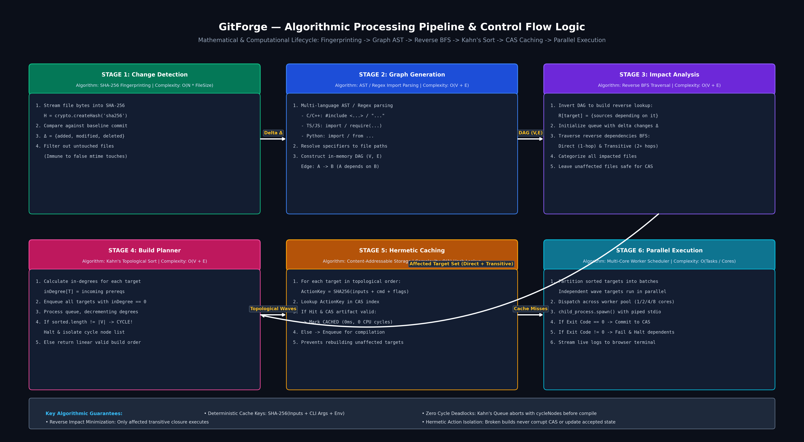
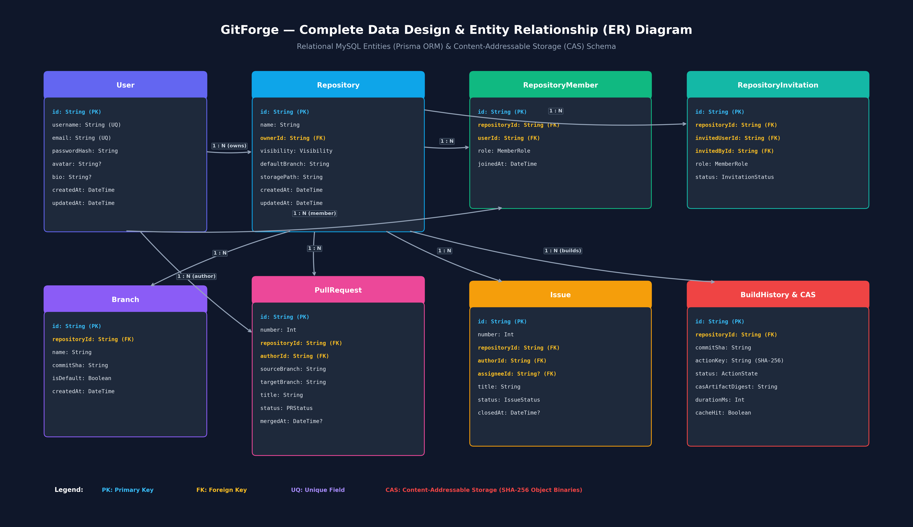

# GitForge: Self-Hosted Git Platform & Incremental Build Engine

GitForge is a high-performance, enterprise-ready code hosting and build execution platform built from scratch with native Git Smart HTTP protocol support, an in-browser Monaco Editor IDE, and a Bazel-inspired incremental build and dependency resolution engine.

---

## 🏛️ System Architecture & Visual Design

### 1. High-Level System Architecture & Component Interaction


GitForge is structured across 5 distinct tiers:
- **Presentation Layer:** React 18, Vite, Tailwind CSS, Monaco Editor, and ReactFlow interactive DAG canvas.
- **Network & Gateway:** HTTP 1.1 REST endpoints and native Git Smart HTTP packet-line (`pkt-line`) streaming RPC (`git-upload-pack`, `git-receive-pack`).
- **Core Engine Subsystems (E1–E4):** Modular TypeScript engines coordinating change detection, AST graph parsing, impact analysis, Kahn's topological sort, and worker execution.
- **Storage Layer:** MySQL 8.0 relational metadata (Prisma ORM), bare Git repositories (`data/repos/`), and Content-Addressable Storage (`data/build-cache/`).
- **Compiler Toolchain:** Direct process execution supporting MinGW GCC/Clang, CMake, Ninja, Node.js, and Python.

---

### 2. Algorithmic Processing Pipeline & Control Flow Logic


The incremental build engine executes a multi-stage mathematical and algorithmic pipeline:
1. **Content Fingerprinting ($O(N \cdot \text{FileSize})$):** Streams file buffers into SHA-256 digests; immune to false rebuilds caused by timestamp touches.
2. **Dependency Graph Generation ($O(V+E)$):** Extracts `#include`, `import`, and `require` statements to construct an in-memory Directed Acyclic Graph (DAG).
3. **Reverse BFS Impact Analysis ($O(V+E)$):** Inverts the graph to traverse downstream dependents, isolating directly affected, transitively affected, and cache-safe files.
4. **Kahn's Topological Sort ($O(V+E)$):** Schedules compilation waves and detects circular dependency cycles before compiler invocation.
5. **Content-Addressable Storage (CAS):** Computes composite `ActionKey = SHA256(inputs + CLI args + env)`. Cache hits skip compilation entirely ($0\text{ ms}$, $0\text{ CPU cycles}$).
6. **Parallel Multi-Core Execution:** Spawns bounded worker processes across 1, 2, 4, or 8 cores with real-time `stdio` streaming.

---

### 3. Data Design & Entity Relationship (ER) Diagram


Relational database models managed via Prisma ORM for MySQL 8.0:
- **`User`**: Account identity, bcrypt password salting/hashing, and profile metadata.
- **`Repository`**: Bare Git mapping, default branch, and visibility controls (Public / Private).
- **`RepositoryMember` & `RepositoryInvitation`**: RBAC permissions (`OWNER`, `ADMIN`, `WRITE`, `READ`).
- **`PullRequest`, `Review`, `Comment`**: Branch diff tracking and automated native Git merge integration.
- **`Issue` & `ActivityLog`**: Issue tracking, discussion threads, and platform audit logs.
- **`BuildHistory` & CAS**: Persists execution metrics and links compiled object binaries (`.o`) by SHA-256 hash.

---

### 4. Security Architecture, RBAC & Trust Boundaries


- **Defense-in-Depth Zones:** Untrusted External Clients $\rightarrow$ Verified Auth Boundary (JWT & Basic Auth) $\rightarrow$ Sandboxed Core Execution.
- **Command Injection Prevention:** Replaced unsafe shell execution (`exec`) with array-argument subprocess vectorization (`child_process.spawn`). Blocks subshells, chaining (`;`, `&&`, `|`), and path traversal (`../`) escapes.
- **Unified RBAC:** Enforces access control consistently across both REST API requests and Git CLI commands.

---

## 🔑 Seeded Demo Accounts

The following demo accounts are available in the local database:

| Username | Email | Password | Role Description |
|---|---|---|---|
| `alice` | `alice@gitforge.dev` | `DemoPassword123!` | Repository Owner (`alice/core-runtime`) |
| `bob` | `bob@gitforge.dev` | `DemoPassword123!` | Collaborator (`WRITE` role on `alice/core-runtime`) |
| `testuser1` | `test1@gitforge.dev` | `pass1234` | Integration test user |
| `testuser2` | `test2@gitforge.dev` | `pass1234` | Integration test user |

---

## 🚀 Running GitForge Locally

### Option 1: One-Click Platform Launcher (Windows)
Run the automated launcher script from the root directory:
```cmd
START_GITFORGE.bat
```
*Automatically verifies MySQL 8.0, starts the backend on port 5000, starts Vite on port 5174, and opens your browser.*

### Option 2: Manual Start

#### Backend Server
```bash
cd server
npm run dev
# Starts backend REST and Git HTTP on http://localhost:5000
```

#### Frontend Development Server
```bash
cd client
npm run dev
# Starts on http://localhost:5174
```

---

## 💻 Git CLI Usage (Smart HTTP)

GitForge functions as a full-featured Git remote without third-party Git daemons:

```bash
# Clone a repository
git clone http://localhost:5000/alice/core-runtime.git

# Make changes and push
git add .
git commit -m "feat: add new feature"
git push origin main
```
*(Enter credentials: username: `alice`, password: `DemoPassword123!`)*

---

## 📂 Academic Documentation & Project Handbooks

All formal review handbooks and requirement specifications are located in the [`docs/`](docs/) directory:
- **Sprint 1 Handbook:** [`docs/CHAPTER_4_SPRINT_1_STUDENT_HANDBOOK.docx`](docs/CHAPTER_4_SPRINT_1_STUDENT_HANDBOOK.docx)
- **Gate 0 Project Synopsis:** [`docs/GATE_0_PROJECT_SYNOPSIS_TEAM_1.docx`](docs/GATE_0_PROJECT_SYNOPSIS_TEAM_1.docx)
- **Gate 1 Requirements Engineering:** [`docs/GATE_1_REQUIREMENTS_ENGINEERING_TEAM_1.docx`](docs/GATE_1_REQUIREMENTS_ENGINEERING_TEAM_1.docx)
- **Technical Documentation & Diagrams:** [`docs/GITFORGE_COMPLETE_TECHNICAL_DOCUMENTATION/`](docs/GITFORGE_COMPLETE_TECHNICAL_DOCUMENTATION/)
