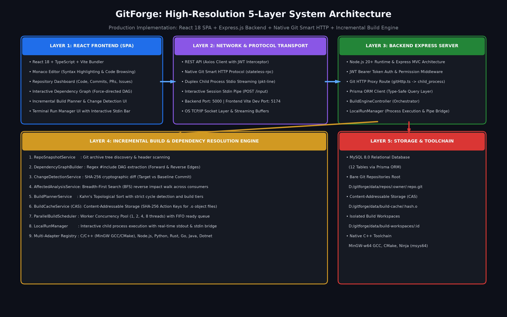
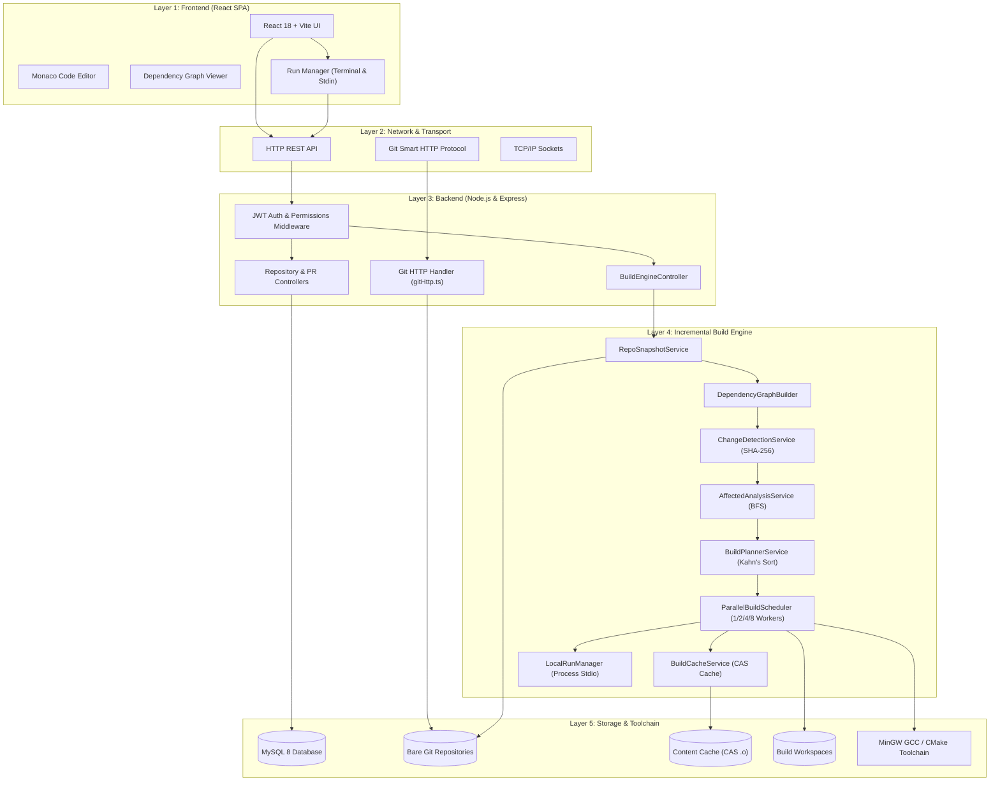

# GitForge Complete System Architecture

## 1. System Architecture Overview

GitForge is designed around a decoupled, 5-layer enterprise architecture that unifies modern code hosting with a high-performance incremental compilation and dependency resolution engine.

*Direct SVG Vector Diagram: [system_architecture.svg](diagrams/system_architecture.svg)*

## 2. The Five System Layers

### Layer 1: Frontend (Client)
- **Technology Stack**: React 18, TypeScript, Vite, Tailwind CSS, Monaco Editor.
- **Responsibilities**:
  - Code browsing and interactive syntax-highlighted editing.
  - Interactive Dependency Graph exploration (force-directed canvas).
  - Incremental Build Execution dashboard with live compilation logs.
  - Interactive Terminal Run Manager with real-time bidirectional stdin/stdout streaming.

### Layer 2: Network & Transport
- **Protocols**: HTTP 1.1 / JSON REST, Git Smart HTTP (stateless-rpc), Raw TCP/IP Sockets.
- **Endpoints**:
  - REST API on `http://localhost:5000/api/*`
  - Git Smart HTTP on `http://localhost:5000/:owner/:repo.git/*`
  - Interactive Session Stdin on `http://localhost:5000/api/repos/:id/build-engine/run-sessions/:sessionId/input`

### Layer 3: Backend (Server)
- **Technology Stack**: Node.js 20+, Express.js, TypeScript, Prisma ORM.
- **Responsibilities**:
  - JWT Authentication and Role-Based Access Control (RBAC).
  - Git Smart HTTP proxying to native Git sub-processes.
  - REST controllers for repositories, pull requests, issues and collaborators.
  - Process coordination for the Incremental Build Engine.

### Layer 4: Incremental Build & Dependency Resolution Engine
- **Engine Components**:
  1. `RepoSnapshotService`: Exports Git trees and maps project hierarchies.
  2. `GraphBuilder`: Analyzes `#include` directives to construct direct and reverse DAGs.
  3. `ChangeDetectionService`: Computes SHA-256 hashes against commit baselines.
  4. `AffectedAnalysisService`: Executes BFS reverse traversals to identify impacted compile targets.
  5. `BuildPlannerService`: Employs Kahn's algorithm for topological sorting and cycle detection.
  6. `BuildCacheService (CAS)`: Content-Addressable Storage for SHA-256 object files (`.o`).
  7. `ParallelBuildScheduler`: Multi-worker parallel compile scheduler (1, 2, 4, 8 cores).
  8. `LocalRunManager`: Interactive subprocess runner bridging terminal stdin to running binaries.

### Layer 5: Storage & Toolchain
- **Datastores**:
  - **MySQL 8.0**: Relational metadata (users, repos, branches, PRs, issues, activity logs).
  - **Bare Git Repositories**: `D:/gitforge/data/repos/:owner/:repo.git`
  - **Build Workspaces**: `D:/gitforge/data/build-workspaces/:repoId/:commitSha`
  - **Content-Addressable Cache**: `D:/gitforge/data/build-cache/:hash.o`
  - **Toolchain**: MinGW-w64 GCC, CMake, Ninja.

## 3. Architecture Mermaid Diagram

