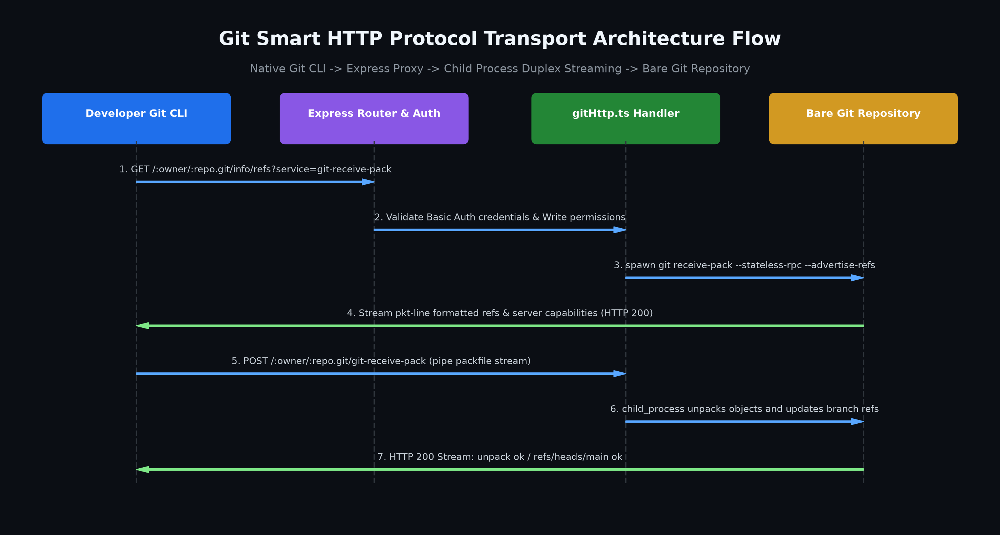
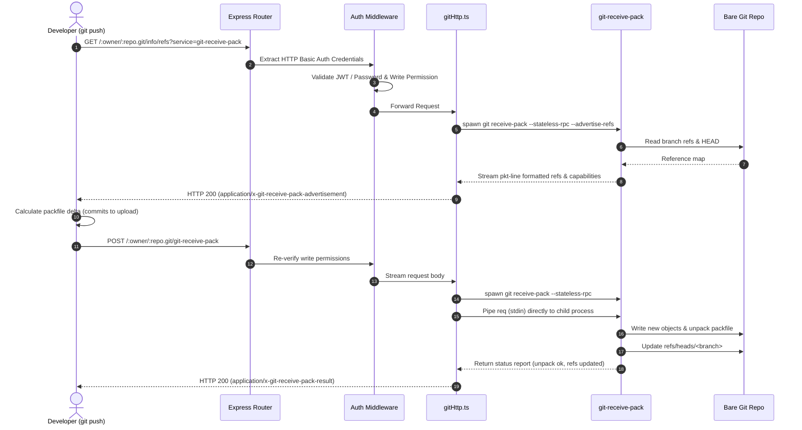

# Git Smart HTTP Transport Protocol: Complete Architecture & Implementation Guide

## 1. Protocol Architecture & Sequence

GitForge implements the native Git Smart HTTP transport protocol (`stateless-rpc`), enabling standard developer tools (`git clone`, `git pull`, `git push`) to seamlessly interact with GitForge over standard HTTP/HTTPS ports.



*Direct SVG Vector Diagram: [git_smart_http_flow.svg](diagrams/git_smart_http_flow.svg)*

## 2. Core Git Smart HTTP Concepts

### What is Git Smart HTTP?
Git Smart HTTP is a bidirectional RPC protocol layered over standard HTTP. Unlike "dumb" HTTP (which downloads raw files from a static web server), Smart HTTP negotiates object transfer between the client's `git` process and server-side Git binaries (`git-upload-pack` and `git-receive-pack`).

### Why GitForge Uses Native Git Subprocesses
Instead of reimplementing complex Git packfile compression, delta resolution, and object packing in JavaScript, GitForge delegates low-level storage operations directly to native `git` binaries. This guarantees 100% specification compliance, optimal performance, and robust repository integrity.

### Bare Git Repositories
GitForge repositories are stored on disk as **bare** Git repositories (ending in `.git`). A bare repository contains the Git database (`objects/`, `refs/`, `HEAD`, `config`) without a working directory checkout, reducing storage overhead and preventing workspace synchronization conflicts.

## 3. Git Push Flow: Step-by-Step



## 4. Key Source Code Implementation (`server/src/routes/gitHttp.ts`)

The streaming bridge is implemented using Node.js child process pipelines without loading full packfiles into server memory:

```typescript
// Excerpt from server/src/routes/gitHttp.ts
router.post('/:owner/:repo.git/git-receive-pack', authenticateGit, async (req, res) => {
  const repoPath = getRepoDiskPath(req.params.owner, req.params.repo);
  
  res.setHeader('Content-Type', 'application/x-git-receive-pack-result');
  res.setHeader('Cache-Control', 'no-cache');

  const gitProcess = spawn('git', ['receive-pack', '--stateless-rpc', repoPath]);

  // Direct zero-copy duplex pipe
  req.pipe(gitProcess.stdin);
  gitProcess.stdout.pipe(res);

  gitProcess.on('exit', (code) => {
    if (code !== 0) {
      console.error(`git receive-pack exited with error code ${code}`);
    }
  });
});
```
