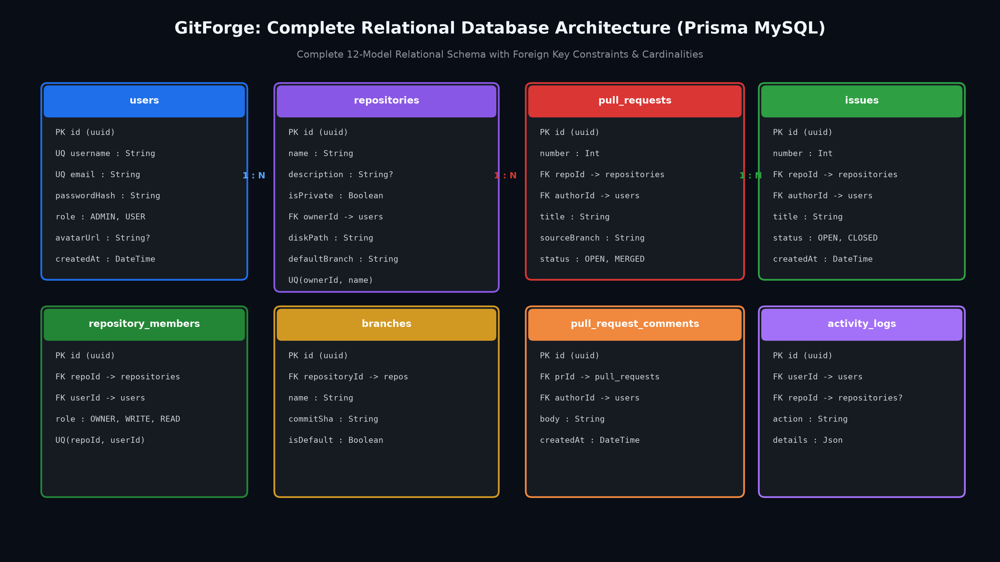
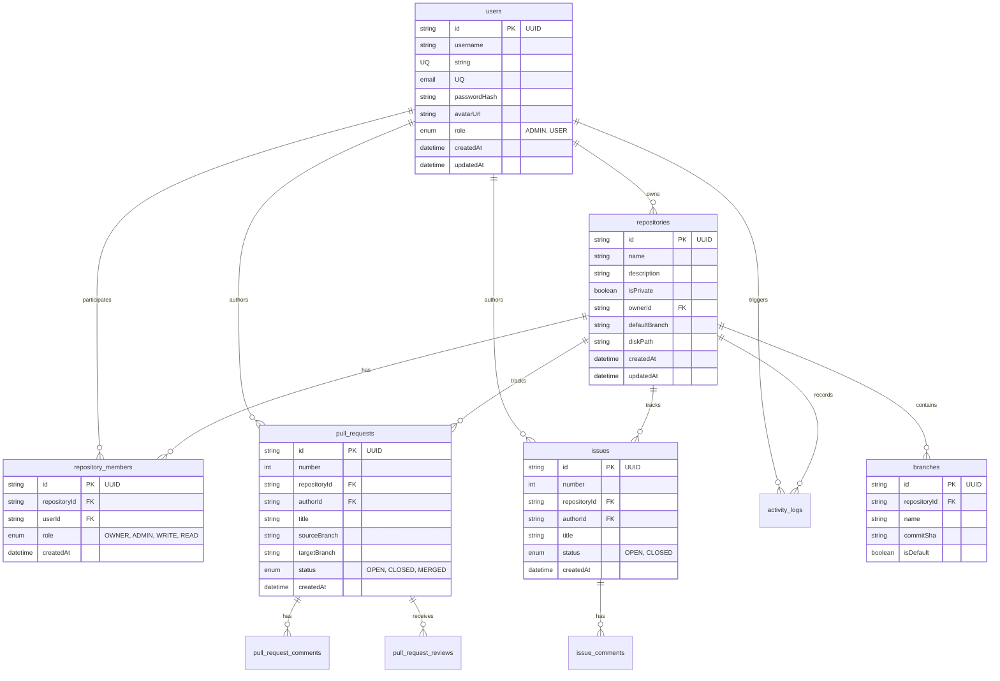

# GitForge Relational Database Architecture & ER Diagram

## 1. Entity-Relationship Overview

GitForge uses MySQL 8.0 managed via the Prisma ORM. The relational schema is structured into 12 normalized models representing users, access control, repository code, branches, collaboration, and audit trails.

*Direct SVG Vector Diagram: [er_diagram.svg](diagrams/er_diagram.svg)*

## 2. Complete Mermaid ER Diagram

## 3. Database Table Definitions

### `users` Table
Stores registered developer identities and credentials.
- `id`: UUID Primary Key.
- `username`: Unique varchar, used in repository URLs (`/:username/:repo`).
- `email`: Unique email for notifications and password recovery.
- `passwordHash`: Bcrypt hashed password string.
- `role`: Platform administration flag (`ADMIN` or `USER`).

### `repositories` Table
Stores logical repository metadata mapped to filesystem bare repos.
- `id`: UUID Primary Key.
- `ownerId`: Foreign key pointing to `users.id`.
- `name`: Repository slug (Unique per owner via composite constraint `@@unique([ownerId, name])`).
- `diskPath`: Absolute filesystem path to the bare repository (`D:/gitforge/data/repos/...`).
- `defaultBranch`: Default checkout branch (defaults to `main`).
