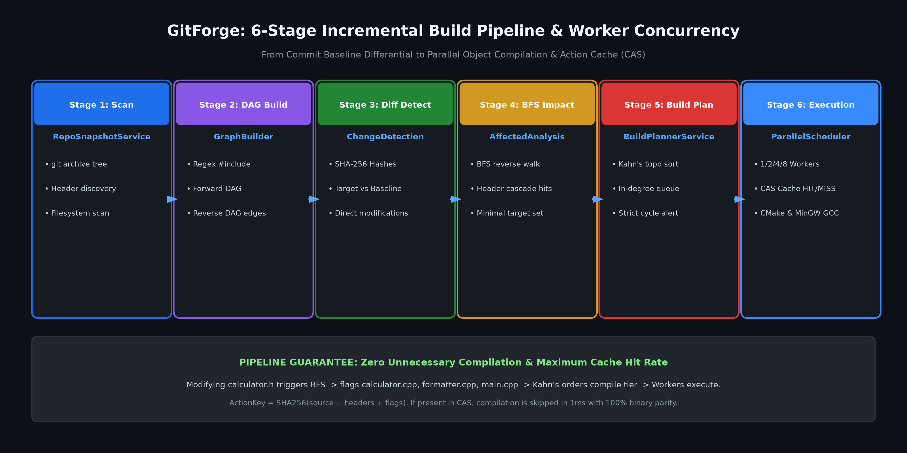
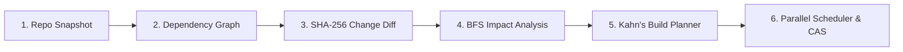
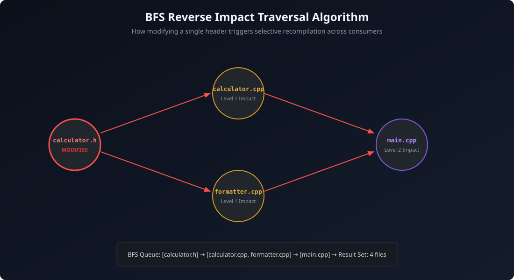

# GitForge Incremental Build & Dependency Resolution Engine

## 1. Engine Pipeline Architecture

The GitForge Incremental Build Engine is a dedicated subsystem that drastically reduces build times for C/C++ projects by identifying changes between Git commits, computing dependency impacts, and selectively compiling only what is necessary while reusing pre-compiled object files from a Content-Addressable Storage (CAS) cache.

*Direct SVG Vector Diagram: [build_pipeline_flow.svg](diagrams/build_pipeline_flow.svg)*

## 2. The 6 Build Engine Stages

### Stage 1: Repository Snapshot (`RepoSnapshotService.ts`)
- Exports the file hierarchy of the selected target commit using `git archive` without polluting disk storage.
- Discovers source files (`.cpp`, `.cc`, `.c`) and header files (`.h`, `.hpp`).

### Stage 2: Dependency Graph Construction (`GraphBuilder.ts`)
- Parses all source files with high-speed regex to locate `#include "..."` and `#include <...>` statements.
- Builds an in-memory Directed Acyclic Graph (DAG) with both:
  - **Forward Edges**: Which headers does file `A` depend on?
  - **Reverse Edges**: Which translation units include header `H`?

### Stage 3: SHA-256 Change Detection (`ChangeDetectionService.ts`)
- Computes SHA-256 cryptographic hashes for every file in the target commit.
- Compares these against the baseline commit (defaults to `HEAD^` if same commit is selected).
- Identifies the minimal set of directly modified files.

### Stage 4: BFS Reverse Impact Analysis (`AffectedAnalysisService.ts`)
- When a header file (`calculator.h`) is modified, compiling only that header is invalid since headers are not translation units.
- Executes Breadth-First Search (BFS) starting from modified headers along **reverse dependency edges**.
- Discovers all direct and transitive `.cpp` consumers that must be recompiled.

### Stage 5: Kahn's Topological Sort & Cycle Detection (`BuildPlannerService.ts`)
- Organizes compilation targets into execution tiers where each tier contains independent compilation actions whose prerequisites have already been satisfied.
- Computes in-degrees for all targets.
- **Cycle Detection**: If the queue empties before all targets are scheduled, a circular dependency exists. GitForge halts the pipeline and highlights the exact cycle path in the web UI.

### Stage 6: Parallel Build Scheduler & Action Cache (`ParallelBuildScheduler.ts`)
- Dispatches compile actions across a configurable worker pool (1, 2, 4, or 8 concurrent threads).
- **Content-Addressable Storage (CAS)**:
  $$\text{ActionKey} = \text{SHA256}(\text{SourceCode} + \text{Headers} + \text{CompilerFlags})$$
- If the `ActionKey` exists in `D:/gitforge/data/build-cache/`, compilation is skipped (`Cache HIT`), and the `.o` object file is restored instantly.
- On `Cache MISS`, MinGW GCC compiles the object file, and it is persisted into the CAS.
- Finally, all object files are linked into the target binary.

## 3. Interactive Terminal & Stdin Support (`LocalRunManager.ts`)

Once compiled, executables can be run directly inside the browser. GitForge includes an interactive stdio bridge supporting programs that require user input (e.g., calculators, menus):
- Child process spawned with duplex pipes.
- Stdout and Stderr are pushed in real-time to the frontend.
- When an interactive prompt pauses execution, the user enters input in the UI input bar.
- Frontend issues `POST /run-sessions/:sessionId/input`, which calls `LocalRunManager.sendInput()`, writing directly to the child process's `stdin` stream.
